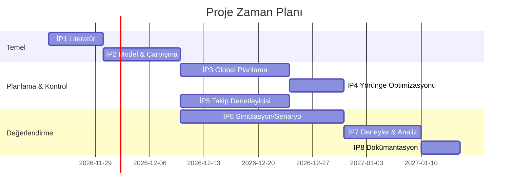
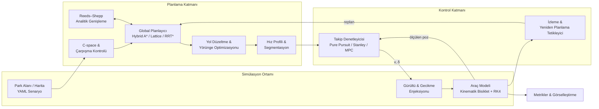

# Autonomous Parking with Nonholonomic Motion Planning

> **Alan:** Autonomous Driving & Optimal Control · **Proje No:** 12

Otonom bir aracın sanal bir park alanında, başlangıç konumundan hareket edip çevredeki engellere çarpmadan hedef park pozisyonuna ulaşmasını sağlayan bir **planlama + kontrol** sistemi. Aracın yanlamasına hareket edememesini (nonholonomik kısıt) ve minimum dönüş yarıçapını hesaba katar.

---

## İçindekiler

1. [Proje Amacı ve Problem Tanımı](#1-proje-amacı-ve-problem-tanımı)
2. [Kapsam ve İş Paketleri](#2-kapsam-ve-iş-paketleri)
3. [Yöntemler ve Algoritmalar](#3-yöntemler-ve-algoritmalar)
4. [Simülasyon Ortamı](#4-simülasyon-ortamı)
5. [Sistem Mimarisi](#5-sistem-mimarisi)
6. [Deneyler](#6-deneyler)
7. [Sonuçlar](#7-sonuçlar)
8. [Proje Yapısı](#8-proje-yapısı)

---

## 1. Proje Amacı ve Problem Tanımı

### 1.1 Motivasyon

Park etmek, sürücülerin en çok zorlandığı manevralardan biridir: dar alan, park etmiş araçlar ve sınırlı görüş bir araya gelir. Araç yanlamasına hareket edemez ve dönüş yarıçapı sınırlıdır. Bu yüzden düz bir geometrik yol (örneğin iki nokta arasında bir doğru) çoğu zaman **fiziksel olarak uygulanamaz**. Bu kısıtları baştan hesaba katan bir hareket planlayıcısına ihtiyaç vardır.

### 1.2 Problem Tanımı

Aracın durumu şu konfigürasyonla tanımlanır:

$$
q = (x,\ y,\ \theta) \in \mathcal{C} = \mathbb{R}^2 \times S^1
$$

Burada $(x, y)$ arka aks merkezinin konumu, $\theta$ ise aracın yönelimidir. Verilenler:

- başlangıç konfigürasyonu $q_{start}$,
- hedef park konfigürasyonu $q_{goal}$,
- engellerin kapladığı bölge $\mathcal{O}$ (park etmiş araçlar, kaldırım, duvarlar),

Amaç, aşağıdaki koşulları sağlayan bir yörünge $q(t)$ ve kontrol girdisi $u(t) = (v, \delta)$ bulmaktır:

1. **Kinematik olarak uygulanabilir:** Nonholonomik kısıtı sağlar,
   $\dot{x}\sin\theta - \dot{y}\cos\theta = 0$.
2. **Sınırlara uyar:** $|\delta| \le \delta_{max}$, yani eğrilik $|\kappa| \le 1/R_{min}$; hız ve direksiyon hızı da sınırlıdır.
3. **Çarpışmasızdır:** Her an için $\mathcal{A}(q(t)) \cap \mathcal{O} = \emptyset$. Burada $\mathcal{A}(q)$, aracın $q$ konfigürasyonunda kapladığı alandır.
4. **Hedefe ulaşır:** $\|q(T) - q_{goal}\|$ belirlenen toleransın altındadır.
5. **Belirli bir maliyeti en aza indirir:** Yol uzunluğu, vites (ileri ↔ geri) değişim sayısı, direksiyon değişimi ve engellere yakınlık.

### 1.3 Proje Hedefleri

- Configuration Space, nonholonomik kısıtlar ve kinematik model kavramlarını uygulamalı olarak göstermek.
- Düz geometrik yol ile kinematik olarak uygulanabilir yol arasındaki farkı **görsel ve sayısal olarak** ortaya koymak.
- İleri–geri manevraların ve park alanı geometrisinin planlamaya etkisini incelemek.
- Planlanan yolun bir **yörünge takip denetleyicisi** ile araç modeli üzerinde gerçekten yürütülebildiğini göstermek.
- Farklı planlama ve kontrol yaklaşımlarını dar alanlarda **başarı, hesaplama maliyeti, güvenlik payı ve konfor** açısından karşılaştırmak.

---

## 2. Kapsam ve İş Paketleri

### 2.1 Kapsam

| Kapsam içi | Kapsam dışı |
|---|---|
| 2B düzlemde kinematik bisiklet modeli | Tam dinamik model (lastik kuvvetleri, kayma) |
| Statik engeller ve bilinen harita | Gerçek sensörlerle algılama ve haritalama (SLAM) |
| Paralel, dik ve açılı park senaryoları | Trafik içinde sürüş ve yaya etkileşimi |
| Konum, yönelim ve aktüatör belirsizliği (gürültü, gecikme) | Gerçek araç üzerinde deney |
| Engel veya hedef değişince yeniden planlama | Çok araçlı koordinasyon |

### 2.2 İş Paketleri

| İP | Başlık | İçerik | Çıktı |
|---|---|---|---|
| **İP1** | Literatür ve gereksinimler | C-space, nonholonomik sistemler, Hybrid A\*, Reeds–Shepp, state lattice, RRT\*, takip denetleyicileri | Literatür özeti, gereksinim listesi |
| **İP2** | Araç modeli ve çarpışma kontrolü | Kinematik bisiklet modeli, araç ayak izi (footprint), çarpışma kontrolü (daire ayrıştırma ve SAT), mesafe haritası | `vehicle/`, `collision/` modülleri |
| **İP3** | Global yol planlama | Düz geometrik yol (referans), Reeds–Shepp analitik eğrileri, Hybrid A\*, State Lattice, RRT\* (Reeds–Shepp steer) | `planning/` modülü |
| **İP4** | Yol düzeltme ve yörünge optimizasyonu | Yolu yumuşatma, hız profili, vites noktalarında durma, optimizasyon tabanlı iyileştirme | `optimization/` modülü |
| **İP5** | Yörünge takip denetleyicisi | Pure Pursuit, Stanley, MPC; ileri ve geri segmentleri ayrı ayrı takip etme | `control/` modülü |
| **İP6** | Simülasyon ve senaryolar | Park alanı üretici, senaryo dosyaları, görselleştirme ve animasyon, gürültü ve gecikme enjeksiyonu | `sim/`, `scenarios/` |
| **İP7** | Deneyler ve analiz | Karşılaştırmalı deneyler, metrikler, istatistiksel analiz, grafikler | `experiments/`, `results/` |
| **İP8** | Dokümantasyon | README, rapor, sunum, demo videoları | `docs/` |

### 2.3 Zaman Planı (öneri)



---

## 3. Yöntemler ve Algoritmalar

### 3.1 Configuration Space (C-space)

Araç tek bir nokta değil, bir dikdörtgendir. Bu yüzden bir konfigürasyonun çarpışmalı olup olmadığı yönelim $\theta$'ya da bağlıdır. Serbest uzay şöyle tanımlanır:

$$
\mathcal{C}_{free} = \{\, q \in \mathcal{C} \mid \mathcal{A}(q) \cap \mathcal{O} = \emptyset \,\}
$$

C-space; $x$, $y$ ve $\theta$ eksenleri boyunca ayrıklaştırılır (örneğin 0.1 m × 0.1 m × 5°). Farklı yönelimler için $\mathcal{C}_{obs}$ dilimleri görselleştirilerek "aynı konumda bir yönelim serbestken diğeri çarpışmalı olabilir" durumu gösterilir.

### 3.2 Kinematik Bisiklet Modeli

Arka aks referanslı model:

$$
\dot{x} = v\cos\theta, \qquad
\dot{y} = v\sin\theta, \qquad
\dot{\theta} = \frac{v}{L}\tan\delta
$$

- $L$: dingil mesafesi, $\delta$: ön tekerlek açısı, $v$: hız ($v<0$ geri vites demektir).
- Minimum dönüş yarıçapı: $R_{min} = L / \tan\delta_{max}$.
- Aktüatör sınırları: $|\delta| \le \delta_{max}$, $|\dot\delta| \le \dot\delta_{max}$, $|v| \le v_{max}$, $|a| \le a_{max}$.

Sayısal entegrasyon için RK4 kullanılır ve adım boyutu $\Delta t$ seçilebilir.

| Parametre | Sembol | Varsayılan |
|---|---|---|
| Dingil mesafesi | $L$ | 2.7 m |
| Araç uzunluğu / genişliği | — | 4.5 m / 1.8 m |
| Maks. direksiyon açısı | $\delta_{max}$ | 35° |
| Min. dönüş yarıçapı | $R_{min}$ | ≈ 3.86 m |
| Maks. park hızı | $v_{max}$ | 1.5 m/s |

### 3.3 Çarpışma Kontrolü

- **Kaba kontrol:** Aracın ayak izi birkaç daireyle örtülür. Engel mesafe haritası (Euclidean Distance Transform) üzerinden $O(1)$ sorguyla kontrol edilir.
- **İnce kontrol:** Kaba kontrol şüpheli sonuç verdiğinde dikdörtgen–çokgen kesişimi **Separating Axis Theorem (SAT)** ile kesin olarak kontrol edilir.
- **Güvenlik payı:** Ayak izi bir $d_{safe}$ marjı kadar büyütülür.
- **Sürekli kontrol:** Yol segmentleri boyunca aradaki pozlar da örneklenerek kontrol edilir, böylece köşe kesme ve "tünelleme" engellenir.

### 3.4 Planlama Algoritmaları

| Algoritma | Tür | Kısaca | Rolü |
|---|---|---|---|
| **Düz geometrik yol** (A\* / doğru) | Holonomik | Yalnızca $(x,y)$ ızgarasında arama yapar, yönelimi yok sayar | **Referans:** Uygulanamaz yolu göstermek için |
| **Reeds–Shepp eğrileri** | Analitik | İleri/geri hareketle iki poz arasındaki en kısa yol (48 kelime ailesi); engelleri yok sayar | Hedefe analitik bağlanma (*analytic expansion*), sezgisel fonksiyon (heuristic) |
| **Hybrid A\*** | Arama tabanlı | Sürekli durumlarla 3B ızgarada A\*. Motion primitive'ler (sol/düz/sağ × ileri/geri) kullanılır | **Ana planlayıcı** |
| **State Lattice** | Arama tabanlı | Önceden hesaplanmış, kinematik olarak uygulanabilir primitive kütüphanesi | Karşılaştırma |
| **RRT\*** (Reeds–Shepp steer) | Örnekleme tabanlı | Asimptotik olarak optimal ağaç arama | Karşılaştırma |

**Hybrid A\* maliyet fonksiyonu:**

$$
g = \sum \big( \ell_i \cdot w_{dir}(i) \big) + w_{\delta}\sum|\delta_i| + w_{\Delta\delta}\sum|\delta_i - \delta_{i-1}| + w_{sw}\cdot N_{switch}
$$

Burada $w_{dir}$ geri gitmeye ek bir ceza katsayısı, $N_{switch}$ ise vites değişim sayısıdır.

**Sezgisel fonksiyon (heuristic):**
$h = \max\big(h_{RS}(q, q_{goal}),\ h_{2D}(q)\big)$

- $h_{RS}$: engelleri yok sayan, kısıtları dikkate alan Reeds–Shepp mesafesi.
- $h_{2D}$: kısıtları yok sayan, engelleri dikkate alan 2B Dijkstra mesafesi.

### 3.5 Yol Düzeltme ve Yörünge Optimizasyonu

Arama tabanlı planlayıcıların çıktısı kırıklı ve gereksiz direksiyon hareketleri içeren bir yoldur. Bu yol iki aşamada iyileştirilir:

1. **Yol yumuşatma:** Eğrilik sınırı korunarak, engellere uzaklık, düzgünlük ve eğrilik terimlerinden oluşan bir maliyet en aza indirilir (gradyan inişi; Dolgov vd., 2010).
2. **Optimizasyon tabanlı iyileştirme (opsiyonel):** Hybrid A\* çözümü başlangıç tahmini olarak kullanılır ve bir doğrusal olmayan programlama (NLP) problemi CasADi + IPOPT ile çözülür. Amaç zaman ve kontrol eforunu azaltmaktır; kısıtlar kinematik model, sınırlar ve engellerden uzaklıktır (OBCA yaklaşımı).
3. **Hız profili:** Yol ileri ve geri segmentlere ayrılır. Her segment için yamuk (trapez) hız profili oluşturulur, vites değişim noktalarında $v=0$ olur.

### 3.6 Yörünge Takip Denetleyicileri

| Denetleyici | Fikir | Avantaj | Dezavantaj |
|---|---|---|---|
| **Pure Pursuit** | Önündeki (lookahead) noktaya doğru yay çizer | Basit ve sağlam | Keskin dönüşlerde köşe keser, lookahead ayarına hassastır |
| **Stanley** | Ön aksın yanal hatası ve yönelim hatası üzerinden çalışır | Düşük hızda iyi takip | Geri vitesin ayrıca ele alınması gerekir |
| **MPC** | Kısıtlı optimal kontrol, kayan ufukla çözülür | Kısıtları doğrudan ele alır, öngörülü çalışır | Hesaplama maliyeti yüksektir |

Geri vites segmentlerinde referans nokta ve işaret kuralları ayrı ayrı ele alınır. Segment geçişlerinde araç tamamen durur ve sonra yön değiştirir.

### 3.7 Belirsizlik ve Yeniden Planlama

- **Konum ve yönelim gürültüsü:** $\mathcal{N}(0, \sigma_{xy}^2)$ ve $\mathcal{N}(0, \sigma_\theta^2)$.
- **Aktüatör belirsizliği:** Direksiyon gecikmesi ($\tau$) ve direksiyon hızı sınırı.
- **Yeniden planlama tetikleyicileri:** Takip hatası eşiği aşıldığında, yeni bir engel ortaya çıktığında veya hedef değiştiğinde.

---

## 4. Simülasyon Ortamı

Python tabanlı, hafif ve tekrarlanabilir bir **2B simülatör** kullanılır.

| Bileşen | Araç / Kütüphane |
|---|---|
| Dil | Python 3.10+ |
| Sayısal hesaplama | NumPy, SciPy |
| Geometri ve çarpışma | Shapely, kendi SAT implementasyonu |
| Optimizasyon / MPC | CasADi + IPOPT |
| Görselleştirme | Matplotlib (animasyon → GIF/MP4) |
| Senaryo tanımı | YAML |
| Test | pytest |

**Senaryo dosyası örneği** (`scenarios/parallel_tight.yaml`):

```yaml
name: parallel_tight
map:
  size: [30.0, 15.0]          # m
  resolution: 0.1             # m/hücre
obstacles:
  - {type: car, pose: [8.0, 2.0, 0.0]}
  - {type: car, pose: [15.5, 2.0, 0.0]}
  - {type: curb, polygon: [[0,0],[30,0],[30,0.8],[0,0.8]]}
start: [4.0, 7.0, 0.0]        # x, y, theta(rad)
goal:  [11.8, 2.0, 0.0]
spot_length: 6.0              # m (araç boyu × ~1.33)
noise:
  sigma_xy: 0.02
  sigma_theta: 0.5            # derece
  steer_delay: 0.1            # s
```

---

## 5. Sistem Mimarisi



**Veri akışı:**

1. Senaryo yüklenir. Harita, ızgaraya ve mesafe haritasına dönüştürülür.
2. Global planlayıcı, $q_{start}$'tan $q_{goal}$'e ileri/geri segmentlerden oluşan bir yol üretir.
3. Yol düzeltilir ve her segmente hız profili eklenir.
4. Takip denetleyicisi her $\Delta t$ adımında $(v, \delta)$ üretir. Bu komutlar gürültü ve gecikmeden geçerek araç modeline uygulanır.
5. İzleme modülü takip hatasını ve yeni engelleri kontrol eder. Gerekirse yeniden planlama başlatır.
6. Tüm durumlar kaydedilir, metrikler hesaplanır ve animasyon üretilir.

---

## 6. Deneyler

### 6.1 Senaryolar

| ID | Senaryo | Açıklama | Zorluk |
|---|---|---|---|
| S1 | Paralel park – geniş | Boşluk ≈ 1.5 × araç boyu | Kolay |
| S2 | Paralel park – dar | Boşluk ≈ 1.2 × araç boyu (çoklu manevra gerekir) | Zor |
| S3 | Dik park | 90° park yeri, dar koridor | Orta |
| S4 | Açılı park | 45° / 60° park yerleri | Orta |
| S5 | Dar koridor + dik park | Koridor genişliği ≈ $R_{min}$ civarı | Zor |
| S6 | Dinamik değişim | Planlama sonrası yeni engel veya hedefin değişmesi | Zor |
| S7 | Rastgele park alanları | Rastgele üretilmiş N adet geometri (istatistiksel analiz) | Değişken |

### 6.2 Deney Grupları

- **D1 – Geometrik yol ve kinematik yol:** Düz geometrik yol araç modeline uygulanır ve kinematik planlayıcının yoluyla karşılaştırılır. Amaç, ilk yolun neden uygulanamadığını göstermektir.
- **D2 – Planlayıcı karşılaştırması:** Hybrid A\*, State Lattice ve RRT\* tüm senaryolarda karşılaştırılır.
- **D3 – Takip denetleyicisi karşılaştırması:** Aynı referans yol Pure Pursuit, Stanley ve MPC ile takip edilir.
- **D4 – Geometri hassasiyeti:** Park boşluğu uzunluğu ve koridor genişliği taranarak başarı oranı ile manevra sayısı ölçülür.
- **D5 – Belirsizlik dayanıklılığı:** Gürültü ve gecikme seviyesi artırılarak hedef hatası ve çarpışma oranı izlenir. Her ayar için ≥ 30 Monte Carlo koşusu yapılır.
- **D6 – Ablasyon:** Yol düzeltmenin, analitik genişlemenin ve vites değişim cezasının etkisi tek tek ölçülür.

### 6.3 Metrikler

| Kategori | Metrik |
|---|---|
| Başarı | Başarı oranı (%), çarpışma oranı (%) |
| Hesaplama | Planlama süresi (ms), genişletilen düğüm sayısı |
| Yol kalitesi | Yol uzunluğu (m), vites değişim sayısı, maks./ort. eğrilik, toplam direksiyon değişimi |
| Güvenlik | Engellere minimum mesafe (m) |
| Takip | RMS yanal hata (m), RMS yönelim hatası (°) |
| Hedef | Son konum hatası (m), son yönelim hatası (°), toplam manevra süresi (s) |

---

## 7. Sonuçlar

> ⚠️ Bu bölüm deneyler tamamlandıkça güncellenecektir. Tablolardaki değerler şu an yer tutucudur.

### 7.1 Planlayıcı Karşılaştırması (D2)

| Senaryo | Planlayıcı | Başarı (%) | Süre (ms) | Uzunluk (m) | Vites Değişimi | Min. Mesafe (m) |
|---|---|---|---|---|---|---|
| S2 | Hybrid A\* | – | – | – | – | – |
| S2 | State Lattice | – | – | – | – | – |
| S2 | RRT\* | – | – | – | – | – |

### 7.2 Takip Denetleyicisi Karşılaştırması (D3)

| Senaryo | Denetleyici | RMS Yanal Hata (m) | Son Konum Hatası (m) | Son Yönelim Hatası (°) | Hesaplama (ms/adım) |
|---|---|---|---|---|---|
| S2 | Pure Pursuit | – | – | – | – |
| S2 | Stanley | – | – | – | – |
| S2 | MPC | – | – | – | – |

### 7.3 Görseller

<!-- Deneyler tamamlandığında eklenecek -->
<!--  -->
<!--  -->

### 7.4 Tartışma

Deney sonuçlarına göre şu sorular yanıtlanacaktır:

- Hangi geometrilerde hangi planlayıcı daha başarılıdır ve neden?
- Başarı, konum/yönelim hatası, hesaplama maliyeti ve güvenlik payı arasındaki ödünleşimler nelerdir?
- Takip denetleyicisi seçimi, planlanan yolun uygulanabilirliğini nasıl etkiliyor?
- Yöntemlerin güçlü ve zayıf yanlarını ortaya çıkaran senaryolar hangileridir?

---

## 8. Proje Yapısı

```
autonomous-parking/
├── main.py
├── requirements.txt
├── scenarios/              # YAML park senaryoları
├── src/
│   ├── vehicle/            # Kinematik bisiklet modeli, parametreler
│   ├── collision/          # Footprint, SAT, mesafe haritası
│   ├── planning/
│   │   ├── geometric.py    # Düz geometrik yol (referans)
│   │   ├── reeds_shepp.py
│   │   ├── hybrid_astar.py
│   │   ├── state_lattice.py
│   │   └── rrt_star.py
│   ├── optimization/       # Yol düzeltme, NLP, hız profili
│   ├── control/            # Pure Pursuit, Stanley, MPC
│   └── sim/                # Simülasyon döngüsü, gürültü, görselleştirme
├── experiments/
│   ├── configs/
│   └── run.py
├── results/
│   ├── figures/
│   └── animations/
├── tests/
└── docs/
```

---

## Lisans

MIT

---

## Proje Üyeleri

| Ad Soyad | Öğrenci No |
|---|---|
| Berkan Kocaman | 032390043 |
| Muhammed Celil Ayhan | 032390059 |
| Umut Çalışkan | 032390066 |
| Hasan Emre Kartal | 032390081 |
